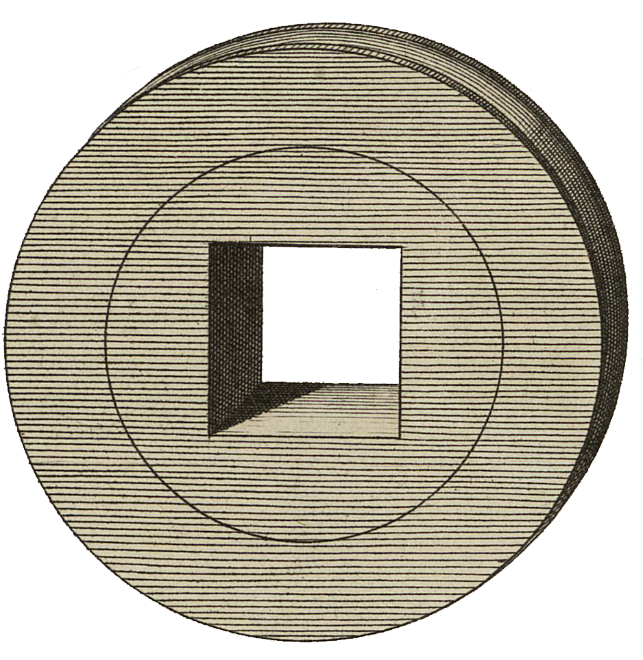

<div align="center" id="head">


<table>
<tr>
<td></td>
<td align="left">
<h1 style="margin:0">Comparator</h1>
<p style="margin:0.25em 0 0"><strong>PDF ↔ Markdown comparison · proofreading · PyQt6</strong><br/>desktop app · page-by-page sync · Markdown editing</p>
</td>
</tr>
</table>

<a href="https://atelier.atechnologie.fr/" title="l'Atelier – book-making and research-tools association"></a>  
<sub>Developed by <a href="https://atelier.atechnologie.fr/">l'Atelier</a> — book-making and research tools (EHESS)</sub>

<p>
🇫🇷 <a href="README.md">Français</a> ·
🇬🇧 <a href="README.en.md"><b>English</b></a> ·
🇩🇪 <a href="README.de.md">Deutsch</a> ·
🇪🇸 <a href="README.es.md">Español</a>
</p>

<p>
<a href="https://atelier.atechnologie.fr/"></a>
<a href="https://github.com/Atelier-Recherche/comparator"></a>
</p>

</div>

---

## 📸 Overview

| Side-by-side view | Markdown editing |
| :---: | :---: |
|  |  |

---

## 📖 About

A Python desktop app (PyQt6) to compare a PDF document with a series of Markdown files **page by page**.

Built for proofreading / correction workflows: synchronized PDF ↔ Markdown navigation, direct Markdown editing, global search/replace, and cleanup utilities.

## 🌟 Main features

- Side-by-side PDF view and Markdown editor.
- PDF / Markdown page sync with configurable offset.
- Detection (or manual setup) of Markdown filename patterns (`page001.md`, `doc - 0007.md`, etc.).
- Markdown editing with save and font controls.
- Search / replace across the Markdown folder (plain text or regex).
- Configurable highlighting (custom patterns) and dynamic highlight between PDF selection and Markdown text.
- Text cleanup panel and orphan coupling panel.
- Project management (`.comparator` / `.json`) to restore a session quickly.
- Persistent preferences (geometry, visible panels, colors, custom shortcuts, last project, etc.).

## 📦 Prerequisites

- Python 3.10+ (recommended)
- pip

Python dependencies:

- `PyQt6>=6.6.0`
- `PyMuPDF>=1.23.0`

## ⬇️ Installation

From the project root:

```bash
python -m venv .venv
```

Activate the virtual environment:

- Windows (PowerShell):

```powershell
.venv\Scripts\Activate.ps1
```

- macOS / Linux:

```bash
source .venv/bin/activate
```

Install dependencies:

```bash
pip install -r requirements.txt
```

## 🚀 Launch

```bash
python main.py
```

## 🧭 Quick start

1. Open the application.
2. Load a PDF via `File > Load PDF...` / `Fichier > Charger PDF...`.
3. Load the Markdown pages folder via `File > Load Markdown folder...` / `Fichier > Charger dossier Markdown...`.
4. Adjust the `Offset` / `Décalage` if PDF page N does not match Markdown page N.
5. Navigate with `Page Up / Page Down` and edit the Markdown.
6. Save the session as a project via `File > Save project` / `Fichier > Enregistrer projet`.

## 💾 Project files

Projects store session data (PDF, Markdown folder, pattern, offset, sync, zoom, font, preferences, etc.) in:

- `*.comparator`
- `*.json`

## 🗂️ Structure (overview)

- `main.py`: application entry point.
- `main_window.py`: main UI and coordination logic.
- `pdf_viewer.py`: PDF display and interactions.
- `markdown_editor.py`: Markdown file editing.
- `search_replace_bar.py` / `search_replace_dialog.py`: search / replace.
- `project_manager.py`: project save / load.
- `config_storage.py`: user configuration persistence.

## ⚠️ Notes

- GUI-oriented application (no dedicated CLI mode).
- PDF annotations and Markdown edits affect source files: work on a copy for sensitive documents.

## 🔗 Resources

| | |
| --- | --- |
| 🌐 **l'Atelier** | [atelier.atechnologie.fr](https://atelier.atechnologie.fr/) |
| 📦 **Repository** | [github.com/Atelier-Recherche/comparator](https://github.com/Atelier-Recherche/comparator) |

---

<div align="center">

<sub><a href="README.md">🇫🇷 Français</a> · <b>🇬🇧 English</b> · <a href="README.de.md">🇩🇪 Deutsch</a> · <a href="README.es.md">🇪🇸 Español</a></sub>

</div>
