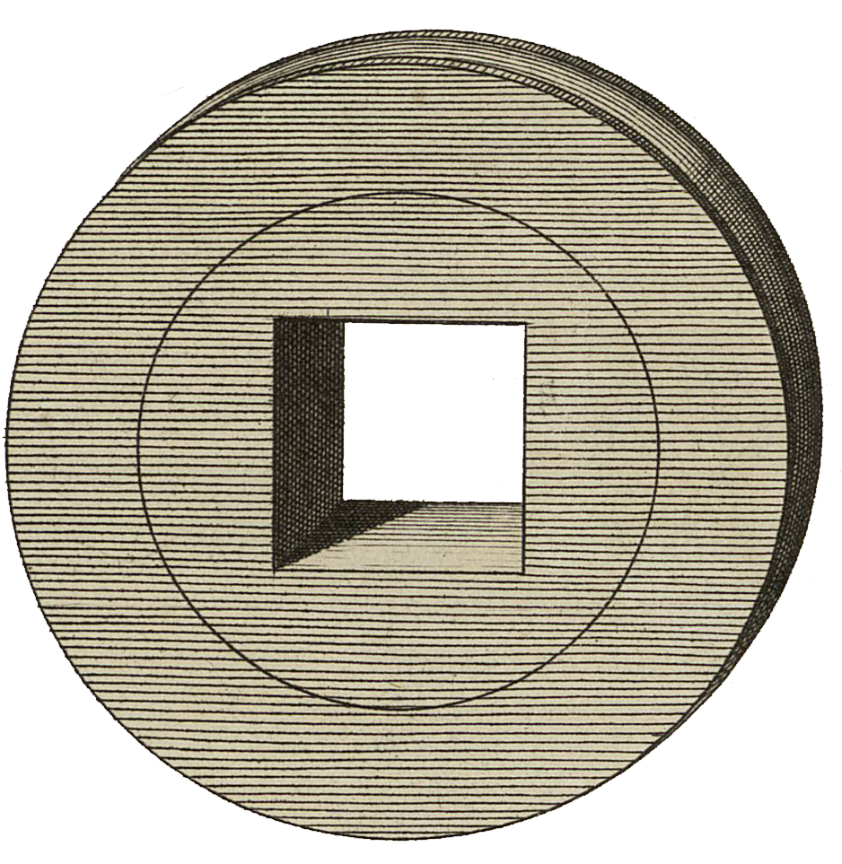

<div align="center" id="head">


<table>
<tr>
<td></td>
<td align="left">
<h1 style="margin:0">Comparator</h1>
<p style="margin:0.25em 0 0"><strong>Comparación PDF ↔ Markdown · relectura · PyQt6</strong><br/>aplicación de escritorio · sync página a página · edición Markdown</p>
</td>
</tr>
</table>

<a href="https://atelier.atechnologie.fr/" title="l'Atelier – asociación de fabricación de libros y herramientas de investigación"></a>  
<sub>Desarrollado por <a href="https://atelier.atechnologie.fr/">l'Atelier</a> — fabricación de libros y herramientas de investigación (EHESS)</sub>

<p>
🇫🇷 <a href="README.md">Français</a> ·
🇬🇧 <a href="README.en.md">English</a> ·
🇩🇪 <a href="README.de.md">Deutsch</a> ·
🇪🇸 <a href="README.es.md"><b>Español</b></a>
</p>

<p>
<a href="https://atelier.atechnologie.fr/"></a>
<a href="https://github.com/Atelier-Recherche/comparator"></a>
</p>

</div>

---

## 📸 Vista previa

| Vista lado a lado | Edición Markdown |
| :---: | :---: |
|  |  |

---

## 📖 Acerca de

Aplicación de escritorio en Python (PyQt6) para comparar un documento PDF con una serie de archivos Markdown **página por página**.

Pensada para flujos de relectura / corrección: navegación sincronizada PDF ↔ Markdown, edición directa del texto Markdown, búsqueda / reemplazo global y utilidades de limpieza.

## 🌟 Funciones principales

- Visualización lado a lado del PDF y del editor Markdown.
- Sincronización de páginas PDF / Markdown con desplazamiento configurable.
- Detección (o configuración manual) del patrón de nombres de archivos Markdown (`page001.md`, `doc - 0007.md`, etc.).
- Edición Markdown con guardado y gestión de la tipografía.
- Búsqueda / reemplazo en todo el carpeta Markdown (texto simple o regex).
- Resaltado configurable (patrones personalizados) y modo de resaltado dinámico entre selección PDF y texto Markdown.
- Panel de limpieza de texto y panel de acoplamientos huérfanos.
- Gestión de proyectos (`.comparator` / `.json`) para restaurar rápidamente una sesión.
- Preferencias persistentes (geometría, paneles visibles, colores, atajos personalizados, último proyecto, etc.).

## 📦 Requisitos previos

- Python 3.10+ (recomendado)
- pip

Dependencias Python:

- `PyQt6>=6.6.0`
- `PyMuPDF>=1.23.0`

## ⬇️ Instalación

Desde la raíz del proyecto:

```bash
python -m venv .venv
```

Activación del entorno virtual:

- Windows (PowerShell):

```powershell
.venv\Scripts\Activate.ps1
```

- macOS / Linux:

```bash
source .venv/bin/activate
```

Instalación de dependencias:

```bash
pip install -r requirements.txt
```

## 🚀 Arranque

```bash
python main.py
```

## 🧭 Uso rápido

1. Abrir la aplicación.
2. Cargar un PDF vía `Fichier > Charger PDF...` / `File > Load PDF...`.
3. Cargar la carpeta de páginas Markdown vía `Fichier > Charger dossier Markdown...`.
4. Ajustar el `Décalage` / `Offset` si la página PDF N no corresponde a la página Markdown N.
5. Navegar con `Page Up / Page Down` y editar el Markdown.
6. Guardar la sesión como proyecto vía `Fichier > Enregistrer projet`.

## 💾 Archivos de proyecto

Los proyectos guardan la información de sesión (PDF, carpeta Markdown, patrón, offset, sincronización, zoom, tipografía, preferencias, etc.) en:

- `*.comparator`
- `*.json`

## 🗂️ Estructura (vista previa)

- `main.py`: punto de entrada de la aplicación.
- `main_window.py`: interfaz principal y lógica de coordinación.
- `pdf_viewer.py`: visualización e interacciones PDF.
- `markdown_editor.py`: edición de archivos Markdown.
- `search_replace_bar.py` / `search_replace_dialog.py`: búsqueda / reemplazo.
- `project_manager.py`: guardado / carga de proyectos.
- `config_storage.py`: persistencia de la configuración de usuario.

## ⚠️ Notas

- Aplicación orientada a interfaz gráfica (sin modo CLI dedicado).
- Las anotaciones PDF y las modificaciones Markdown afectan a los archivos fuente: se recomienda trabajar sobre una copia para documentos sensibles.

## 🔗 Recursos

| | |
| --- | --- |
| 🌐 **l'Atelier** | [atelier.atechnologie.fr](https://atelier.atechnologie.fr/) |
| 📦 **Repositorio** | [github.com/Atelier-Recherche/comparator](https://github.com/Atelier-Recherche/comparator) |

---

<div align="center">

<sub><a href="README.md">🇫🇷 Français</a> · <a href="README.en.md">🇬🇧 English</a> · <a href="README.de.md">🇩🇪 Deutsch</a> · <b>🇪🇸 Español</b></sub>

</div>
